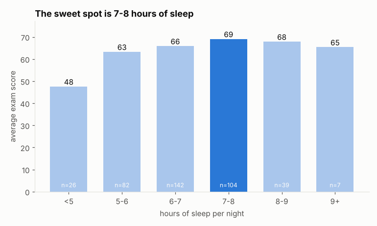
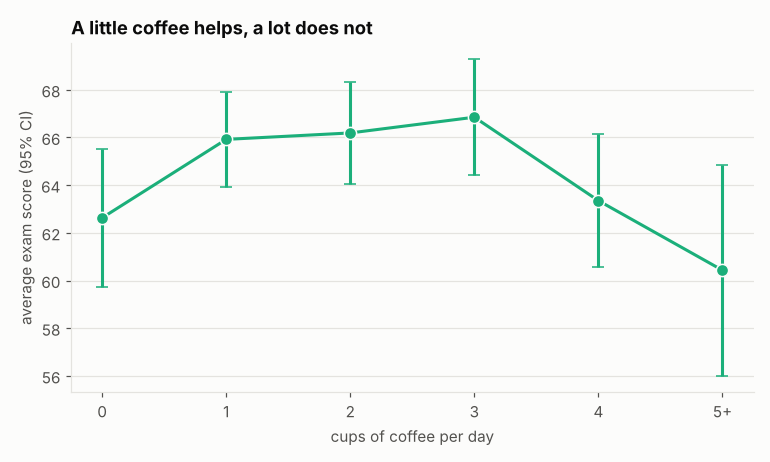
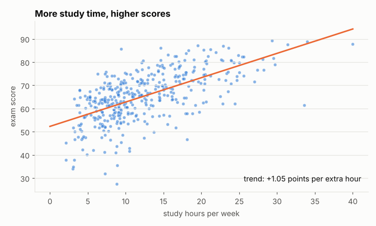
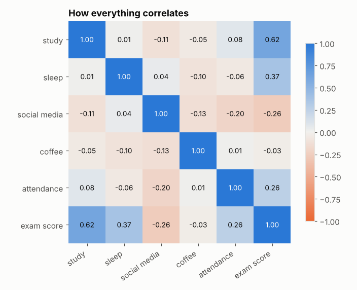
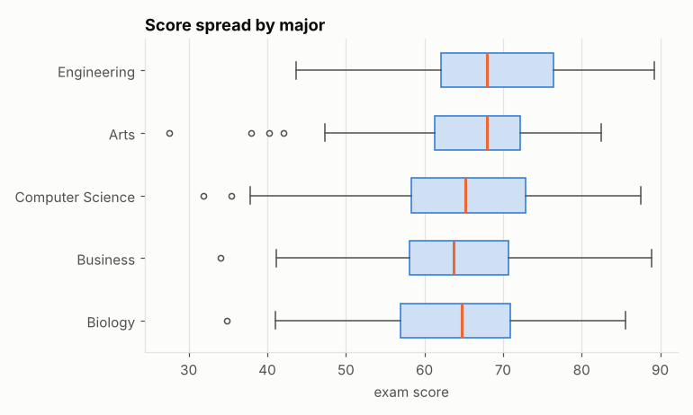

# ☕ Study Habits vs Exam Scores

A pandas data-cleaning and analysis project. It takes a messy student survey export (inconsistent spellings, units typed into number columns, missing answers, impossible values, duplicate rows), cleans it, and answers a few questions I actually wondered about:

- Does studying more really help, and by how much?
- Is there a "right" amount of sleep?
- Does coffee help or hurt?
- Does having a part-time job make a difference?

> ⚠️ **The data is simulated.** There is no real student data in this repo. `simulate.py` generates 400 fake students with a seeded random generator and relationships I picked on purpose, and then `make_messy()` breaks the data in realistic ways. The point of the project is practising the workflow (cleaning, grouping, plotting, modelling), not making claims about real students.



## Findings (on the simulated data)

| Question | Answer |
|---|---|
| Strongest link with exam score | **study hours** (r = 0.62), about **+1 point per extra weekly hour** |
| Best amount of sleep | **7–8 hours** (average 69). Under 5 hours averages 48 |
| Coffee | an **upside-down U**: 1–3 cups score highest, 5+ cups score lowest |
| Social media | negative (r = -0.26), about -1.4 points per daily hour in the model |
| Part-time job | students with jobs averaged 4 points lower, and slept and studied a bit less |
| Linear model | the five habits explain **59%** of the variation in scores (R² = 0.59) |

The coffee result was my favourite: its **correlation with score is about zero (-0.03)**, but grouping by cups shows a clear peak in the middle. The two effects cancel out in a single correlation number, so you only see it when you plot it.

<p>
  
  
</p>
<p>
  
  
</p>

The full generated report with every table is in [docs/REPORT.md](docs/REPORT.md), and there is a step-by-step walkthrough in [notebooks/exploration.ipynb](notebooks/exploration.ipynb).

## Quick start

```bash
git clone https://github.com/blackdalc7/study-habits-analysis.git
cd study-habits-analysis
python -m venv .venv && source .venv/bin/activate     # Windows: .venv\Scripts\activate
pip install -r requirements-dev.txt

PYTHONPATH=src python -m study_habits                   # Windows PowerShell: $env:PYTHONPATH="src"
```

```
raw rows     : 408
clean rows   : 400
best sleep   : 7-8 hours
model R²     : 0.59
charts       : study_vs_score.png, sleep_vs_score.png, coffee_vs_score.png, correlation_heatmap.png, score_by_major.png
report       : docs/REPORT.md
```

Options: `--students 1000` for a bigger sample, `--seed 1` for a different random sample.

To open the notebook:

```bash
jupyter notebook notebooks/exploration.ipynb
```

## The pipeline

```
simulate()  ──▶  make_messy()  ──▶  data/survey_raw.csv  ──▶  clean()  ──▶  data/survey_clean.csv
                                                                              │
                                              docs/REPORT.md  ◀──  analysis  ◀─┤
                                              docs/charts/*.png ◀── charts  ◀──┘
```

### 1. The mess (`simulate.make_messy`)

| Problem | Example |
|---|---|
| Free-text majors | `CS`, `Comp Sci`, `compsci `, `Bio`, `Engg` |
| Units in number columns | `"2 cups"`, `"7.5h"` |
| Inconsistent yes/no | `Y`, `Yes`, `TRUE`, `N`, `no`, `FALSE` |
| Missing answers | blank cells |
| Impossible values | 75 hours of sleep, 180% attendance |
| Duplicate submissions | 8 rows submitted twice |

### 2. Cleaning (`clean.py`)

Each step is logged so the report shows exactly what changed:

| Step | Rows / values |
|---|---|
| duplicate rows removed | 8 |
| major spellings standardised | 133 |
| units stripped (`"2 cups"` → 2) | 40 |
| impossible values set to missing | 7 |
| missing values filled with the major's median | 42 |

Some techniques used:

- `Series.str.extract(r"(-?\d+(?:\.\d+)?)")` pulls the number out of text like `"7.5h"`
- `Series.between(lo, hi)` finds impossible values, which become `NaN` instead of being deleted, so the rest of that student's answers are kept
- `groupby("major")[col].transform("median")` fills gaps with the median for the student's own major, not the global median
- `pd.Categorical` gives majors a fixed set of allowed values
- `pd.cut` turns sleep hours into buckets (`<5`, `5-6`, … `9+`)

A test checks that cleaning **recovers the exact original values** wherever the mess was only cosmetic (spelling or units), which is a nice way to prove the cleaning is right.

### 3. Analysis (`analysis.py`)

Correlations, grouped means with `groupby` and `pivot_table`, standard errors for the coffee chart, and a multiple linear regression written with plain NumPy:

```python
design = np.column_stack([np.ones(len(x)), x])          # add an intercept column
beta, *_ = np.linalg.lstsq(design, y, rcond=None)       # least squares fit
r_squared = 1 - ((y - design @ beta) ** 2).sum() / ((y - y.mean()) ** 2).sum()
```

### 4. Charts (`charts.py`)

Five matplotlib charts with a consistent, colour-blind-friendly style: one highlighted bar for the answer, direct labels instead of legends, light grids, and titles that state the finding rather than just naming the axes.

## Project structure

```
src/study_habits/
├── simulate.py    generates the fake survey, then makes it messy
├── clean.py       cleaning steps + CleaningLog
├── analysis.py    summary, correlations, grouped tables, linear model
├── charts.py      matplotlib charts
└── report.py      CLI that runs everything and writes REPORT.md
notebooks/
└── exploration.ipynb   the same analysis step by step, with outputs
data/              survey_raw.csv and survey_clean.csv (regenerated by the CLI)
docs/              REPORT.md and charts/
tests/             32 pytest tests, about 99% coverage
```

## Tests

```bash
pytest --cov
ruff check .
```

## What I'd do next

- [ ] Add a `coffee²` term so the linear model can capture the U shape
- [ ] Train/test split and compare with scikit-learn's `LinearRegression`
- [ ] Run the same survey on real (anonymous, consenting) classmates
- [ ] An interactive version with Plotly or Streamlit

## License

MIT, see [LICENSE](LICENSE).
